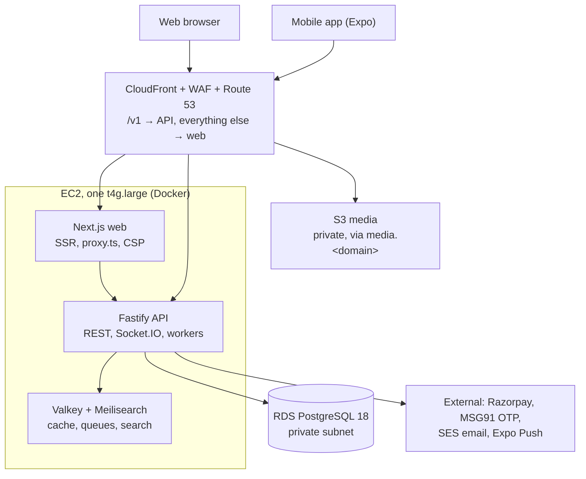
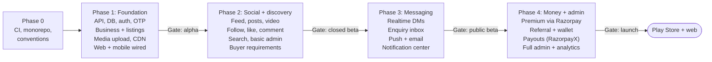

# Supporters — Product Spec

Oct 28, 2026 · @The velnix

## Overview

Supporters is a B2B and local-business discovery network: businesses create a LinkedIn-style page, list products and services, and post Instagram-style updates; buyers discover them, follow them, and talk to them over DMs and enquiries.

- **Who it serves:** Indian manufacturers, wholesalers, retailers, distributors, brands and service providers (supply side), and buyers or consumers looking for them (demand side).
- **Platforms:** web (Next.js 16) and a mobile app (Expo / React Native, Android first). Both share one backend API.
- **Market defaults:** INR (₹), GSTIN on business profiles, UPI and bank payouts, Razorpay for payments.
- **Starting point:** web and mobile UIs exist for almost every screen, but run on mock data. The main job now is the backend, real auth, and wiring the UIs to it.

## Roles and accounts

There is one account type, identified by an Indian mobile number. Any user can add **one** business page in v1, so a single login covers both buying and selling. Every default marked *proposed* in this spec is listed under Decisions and assumptions for the client to confirm.

| Role | Can do | How they get it |
| --- | --- | --- |
| Guest | Browse the feed, Discover, search, and business, product and service pages. Any action (like, follow, message, enquiry) prompts sign-up | No login |
| User | Follow businesses, like, comment, share, save, DM and send enquiries to businesses, post buyer requirements, review businesses, refer, use the wallet | Sign up with a mobile number verified by SMS OTP |
| Business owner | Everything a User can do, plus one business page with products, services, posts, an enquiry inbox, quotes on buyer requirements (once verified) and analytics | A User completes business onboarding |
| Premium business | Owner features plus the Premium perks (see Monetization) | The owner buys Premium for that business on the web |
| Admin | Verify businesses, moderate reports, approve withdrawals, manage categories, suspend accounts | Created by us through a seed script, with no self-signup. Two-factor login is required |

**Signup and onboarding**

1. Enter name, Indian mobile number (+91), password, and an optional referral code. Email is optional at this step.
2. Verify the mobile number with a 6-digit SMS OTP. The account is created only after this succeeds.
3. Pick a city and up to 5 interest categories, which seed the home feed.
4. Optionally add an email and verify it with a 6-digit code sent by email. A verified email is needed for email notifications and invoices.
5. Optionally create a business: name, type, category, city and state, logo and cover, about, contact details, and GSTIN (optional).
6. A profile completion % nudges owners to add hours, socials, a map link and a contact person.

**Login:** mobile number or verified email, plus password. **Forgot password:** an OTP goes to the mobile number (or the verified email), then the user sets a new password, which signs out all other devices.

**Business page (LinkedIn-style):** cover, logo, verified badge, about, established year, tags, rating and reviews, follower count, response rate, contact (phone hidden or shown), socials, address with map, opening hours, and tabs for Products, Services and Posts.

**Verification (free, separate from Premium):** the owner requests the badge from the Business Hub and uploads a GSTIN certificate *or* a Udyam registration certificate, plus an owner photo ID. Documents go to private storage, which only admins can open through short-lived links. An admin checks the number on the government portal, then approves or rejects with a reason within 2 working days. Only verified businesses can quote on buyer requirements. Changing the business name or GSTIN removes the badge until the business is verified again.

## Listings: products and services

Listings are catalog entries, not a checkout: a buyer acts on one by sending an enquiry or a DM. There is no cart or online order in v1.

| Field | Product | Service |
| --- | --- | --- |
| Core (required) | Title (max 120 chars), category, description (max 5,000 chars), 1 to 10 images | Title, category, description, 1 to 10 images |
| Price | Optional price per unit, plus an optional original price (strike-through). With no price, the listing shows "Ask for price" | Optional starting price plus price unit (per hour, per job, per month) |
| Order terms | Minimum order quantity (MOQ) and unit (piece, kg, metre, box, and so on) | Turnaround time |
| Availability | In Stock, Made to Order, Available for Bulk | Immediate, Within 24 Hours, By Appointment |
| Reach | Delivery time, plus shipping areas (All India, or a list of states) | Service area (city, state or All India) |
| Details | Technical specifications: up to 30 key and value pairs | Feature list: up to 15 items |
| Status | Draft, Published, Archived. Only published listings are public and indexed | Same |

- Owners manage listings from the Business Hub: create, edit, archive and delete. Free businesses can have up to 25 published listings (products and services combined); Premium has no limit (*proposed*).
- The detail page shows a gallery, specs, the seller card (with the business rating), Contact Supplier (enquiry), Message, Share and Save, plus up to 8 related listings from the same category.
- Categories are a two-level taxonomy (category, then subcategory) that admins edit. The client supplies the starting list.
- "Featured" is not set by owners. It is a Premium perk that boosts the listing in Discover and search.
- Images are uploaded to private storage, re-encoded, and served through the media CDN in 3 sizes (thumbnail 320 px, card 720 px, full 1600 px).

## Reviews and ratings

Reviews are on **businesses only**, not on individual listings. That keeps ratings meaningful while volumes are low (*proposed*).

- **Who can review:** a user who has had a chat or enquiry thread with that business, opened at least 24 hours earlier. One review per user per business. Owners cannot review their own business.
- **Content:** 1 to 5 stars plus text of 20 to 1,000 characters. The author can edit or delete it at any time.
- **Owner reply:** one public reply per review, which the owner can edit.
- **Rating shown:** the average of visible reviews, to one decimal, with the review count. A business with fewer than 3 reviews shows "New" instead of an average.
- **Moderation:** any user can report a review. Admins can hide it, and hidden reviews leave the average.

## Feed and social

Only business pages post. Users follow, react and share, the way Instagram and LinkedIn company pages work.

- **Post types:** product, service, update, offer (with an offer tag such as "20% off" and an optional end date), and testimonial.
- **Post content:** text up to 2,200 characters, plus either 1 to 10 images or one video (MP4, up to 60 s and 100 MB, 16:9 or 9:16). A product or service from the same business can be attached as a card linking to its listing.
- **Post states:** Draft, Published, Archived. Only the owner can edit or delete. Free businesses can publish up to 10 posts per 7 days; Premium has no limit (*proposed*).
- **Interactions:** like, comment, share (copy link, WhatsApp, native share sheet), save. Comments are text only (up to 1,000 characters) with one level of replies. Authors can delete their own comments, and post owners can delete any comment on their post.
- **Follow graph:** users follow **businesses only** in v1. Business pages show a follower count and list. User profiles show what they follow, but have no followers (*proposed*; the prototype's user follower count is hidden).
- **Home feed (signed in):** the newest posts from followed businesses first. When those run out, newest posts from the user's city, then state, in their interest categories. Posts the user has already seen are skipped. Cursor-paginated, 20 per page.
- **Home feed (guest):** the newest posts in the chosen city (default: All India), with sign-up prompts every 10 posts.
- **Moderation:** anyone can report a post, comment, review, message or business with a reason (spam, fraud, offensive, wrong category, other). Admins can dismiss the report, hide the content, warn, or suspend the account. Posts hidden automatically after 5 distinct reports wait for admin review.

## Discovery and buyer requirements

Buyers find sellers in three ways: search, browsing, and posting what they need so sellers come to them.

- **Search:** one box with tabs for Businesses, Products, Services and Posts. It is typo-tolerant, with autocomplete after 2 characters (up to 8 suggestions). Only published, non-hidden content from active accounts is searchable.
- **Filters:** category and subcategory, city and state, business type, verified only, price range (products and services with a price), availability, maximum MOQ, and minimum rating (businesses).
- **Sort:** relevance (default), newest, rating, price low to high, price high to low.
- **Browse:** a category scroller on the feed, plus the Discover page sections. **Trending** shows businesses with the most new followers and enquiries in the last 7 days. **Featured** shows Premium listings. **Near you** shows the user's city. **Suggested** shows businesses in the user's interest categories that they don't follow yet.
- **Saved:** bookmarked posts, products, services and businesses, in one list with type tabs.
- **Public SEO:** business, product and service pages are server-rendered, with a sitemap and robots file (already scaffolded).

**Buyer requirements (reverse discovery)**

- **Who posts:** any signed-in user. Fields: description (20 to 1,000 characters), category, quantity and unit, delivery city, an optional budget, and up to 3 images. Limits: 3 new requirements per day and 10 open at once.
- **Lifetime:** open for 30 days, then expired. The buyer can close it early or mark it fulfilled.
- **Matching:** a requirement is shown to businesses in the same category whose service area or shipping areas cover the delivery city. They see it as a pinned "Buyer Requirement" card in their feed and in a Requirements list. The 50 best-matching verified businesses (Premium first) also get a notification.
- **Quotes:** only verified businesses can quote, once per requirement, with a price, a message and an optional attached listing. A quote opens (or reuses) the DM thread between the buyer and that business, and notifies the buyer.
- **Privacy:** the buyer's name and city are shown. Phone and email never are.
- **Moderation:** requirements can be reported like posts.

## Messaging: DMs and enquiries

DMs and enquiries share one inbox. An enquiry is a structured first message that opens a DM thread and also shows up in the business's enquiry list.

**Direct messages**

- **Who talks to whom:** every conversation is 1:1 between a user and a business, so there is at most one thread per pair. There are no user-to-user DMs and no group chats in v1. The business side is answered by its owner. An owner can also message other businesses as a user.
- **Content:** text (up to 4,000 characters), images (up to 5 per message), PDF documents (up to 10 MB), and a product or service card.
- **Real time over WebSockets:** online status, a typing indicator, "sent" and "read" ticks, and unread counts. There is no separate "delivered" state in v1.
- **Controls:** conversation list with search by name. A user can mute a thread (no push), block a business or user (no new messages either way, and the thread is hidden), and report a message.
- **History and privacy:** messages are kept for as long as both accounts exist. There is no edit; delete-for-me only. Attachments in chat are private: they open through short-lived signed links and never through public URLs.

**Enquiries (Contact Supplier)**

- **Form fields:** product or service (pre-filled from the page you came from), quantity and unit, delivery city, message (20 to 1,000 characters), and a checkbox to share the buyer's verified phone number with this business.
- **Threading:** an enquiry is posted into the existing user-to-business thread if there is one, or starts it if not. It appears as a highlighted enquiry card.
- **Limits:** 20 enquiries per user per day, and 1 per listing per 24 hours.
- **Business side:** an Enquiries page with statuses New, Responded and Closed. The first owner reply moves an enquiry to Responded automatically, and the owner closes it by hand. Filters by status, date and listing.
- **Response rate:** the share of enquiries from the last 90 days answered within 24 hours. **Response time:** the median time to the first reply. Both show on the business page once it has 5 or more enquiries.

## Notifications

Every notification is stored in-app. Push and email go out only for the events marked below, and users can switch each category off in Settings.

| Event | Who gets it | In-app tab | Push | Email |
| --- | --- | --- | --- | --- |
| New DM | Recipient | Messages | Yes (unless muted) | No |
| New enquiry | Business owner | Enquiries | Yes | Yes |
| First reply to an enquiry | Buyer | Enquiries | Yes | No |
| Buyer requirement matches my business | Matched business owner (top 50) | Enquiries | Yes | No |
| Quote on my requirement | Buyer | Enquiries | Yes | Yes |
| New follower, like, comment, review | Business owner | Business | Batched | No |
| Reply to my comment | Comment author | Business | Batched | No |
| Business verified or rejected | Owner | Business | Yes | Yes |
| Referral pending, credited or ineligible | Referrer | Referrals | Yes | No |
| Withdrawal approved, paid or rejected | User | Referrals | Yes | Yes |
| Premium renewing in 7 days, renewed, payment failed, expired | Owner | Subscription | Yes | Yes |
| New login, password changed, payout details changed | User | Account | Always | Always |
| Content hidden or account warned by an admin | Author | Account | Yes | Yes |

- The in-app list is grouped Today, Yesterday and Earlier, with mark-as-read, mark-all-read and a deep link to the item. Notifications older than 90 days are deleted.
- Push goes through Expo Push (FCM and APNs) on mobile and Web Push in supported browsers. Web Push is opt-in from Settings, never on first visit. Email goes through Amazon SES, and only to a verified email.
- Likes, comments and follows are batched per post or business in a 10-minute window ("Ravi and 12 others liked your post"). Security events (new login, password change, payout details change) always send push and email and cannot be switched off.
- Quiet hours: no non-urgent push between 22:00 and 08:00 IST. Those notifications wait in the in-app list.

## Monetization, wallet and Business Hub

Revenue comes from one plan, Supporters Premium, at ₹999/year **per business**, GST-inclusive (*proposed*), auto-renewing through Razorpay. Referral rewards are paid from that revenue.

**Premium subscription**

- **Perks (*proposed*):** Premium badge, featured placement in Discover and a boost in search, unlimited listings and posts, full analytics history (free plans see the last 7 days), and priority in buyer-requirement matching.
- **Where to buy:** on the **web only** in v1. Google Play and the App Store require their own billing for digital subscriptions sold in-app, so the mobile apps show Premium status and perks but have no buy button or purchase link (*proposed*; revisit Play's alternative billing later).
- **Billing:** Razorpay Subscriptions with UPI AutoPay, cards and netbanking. A GST invoice (PDF, with the client's GSTIN, and the buyer's GSTIN if given) is emailed and kept in the Hub.
- **Renewal and failure:** reminder 7 days before renewal. If a payment fails, Razorpay retries, and the business keeps Premium for a 7-day grace period. After that, perks switch off but no content is deleted. Listings over the free limit become unpublished, and the owner chooses which ones to keep.
- **Cancel:** turns off auto-renew, and Premium stays active until the end of the paid year.
- **Refunds:** full refund within 7 days of the first purchase, and renewals are non-refundable (*proposed*; must match the Refund Policy page).

**Referral and earn** (rules already coded in the prototype)

- Every user gets a referral code and a share link. The code is entered at signup and can't be added later.
- **Successful referral (*proposed*):** the referred user verifies their phone, creates a business and buys Premium. The referral stays Pending for 7 days (the refund window), then turns Successful, and the reward is credited to the referrer's wallet.
- **Rewards:** ₹300 for the 1st successful referral, ₹200 for the 2nd, and ₹0 after that, for a lifetime cap of ₹500 per user (already coded in `lib/referral.ts`).
- **Ineligible when:** it is a self-referral, the phone number or device was used by an earlier account, the payment is refunded, or the referred account is suspended. Status moves through Pending, Successful, Ineligible and Failed, and each status shows its reason.

**Wallet**

- The balance is the sum of an append-only ledger and is never edited directly. Entry types: referral reward, bonus (admin, with a reason), reversal, and withdrawal.
- **Withdrawals:** minimum ₹100, one pending request at a time, to UPI or a bank account (IFSC). The payout account's holder name is checked through RazorpayX account validation before the first payout.
- **Flow:** Pending, then an admin approves (Processing) or rejects with a reason, then RazorpayX pays out (Completed), or the payout fails and the amount returns to the wallet. Target: paid within 3 working days of the request.
- **Fees:** payout fees are paid by Supporters, not deducted from the user.
- **Safety:** after payout details change, withdrawals are blocked for 24 hours, and the user is alerted by push and email.

**Business Hub** (owner dashboard)

- Manage page, products, services, posts, enquiries, verification, Premium and settings.
- **Analytics** (daily figures, viewable for the last 7, 30 or 90 days):
  - **Profile views:** unique signed-in viewers, plus guest sessions, per day. The owner's own views are excluded.
  - **Catalogue clicks:** opens of the business's product and service pages.
  - **Enquiries:** count of enquiries received.
  - **Conversion:** enquiries ÷ profile views, shown next to the platform-wide average.
  - **Feed impressions:** the business's posts shown at least 50% on screen for at least 1 second, counted once per viewer per post per day.
  - **Engagement by region:** viewers and enquiries grouped by the viewer's state (from their profile city).
- Analytics are first-party only. No third-party tracking scripts are used.

## Build status and gaps

The screens are about 80% done on both platforms. The backend is at 0%: there is no API, database, real auth, file upload, realtime or payments. Every screen reads from `lib/mock-data` (web) or `mock.ts` (mobile).

| Area | Web UI | Mobile UI | Backend | Main gap |
| --- | --- | --- | --- | --- |
| Auth, OTP, onboarding | Done | Done | None | Real auth, OTP provider, sessions |
| Business page and Hub | Done | Done | None | CRUD API, image upload, verification flow, reviews (new) |
| Products and services | Done | Product detail only | None | Service detail on mobile, CRUD API |
| Feed, posts, likes, saves | Done | Done | None | Comments UI, feed ranking, video upload |
| Follow graph | Done | Done | None | API |
| Search and Discover | Basic | Basic | None | Search index, filters |
| Buyer requirements | Modal + card | Partial | None | Matching, quote flow |
| DMs | Done (static) | Done (static) | None | WebSocket server, attachments |
| Enquiries | Done | Modal only | None | Business enquiry inbox on mobile |
| Notifications | List UI | List UI | None | Event pipeline, push, email |
| Wallet, referral, withdraw | Done | Done | None | Ledger, RazorpayX payouts |
| Subscription | Done | Done | None | Razorpay subscriptions and invoices on web; the mobile screen becomes status-only |
| Analytics | Mock charts | None | None | Event tracking, aggregation |
| Admin panel | None | None | None | Everything; built as an /admin area in the web app |

**Stack:** Fastify 5 API on Node.js 24 LTS with PostgreSQL 18 and Prisma, Valkey (Redis-compatible) for cache and queues, Socket.IO for chat, Meilisearch for search, Razorpay and RazorpayX, Expo Push, Amazon SES for email and MSG91 for SMS OTP. Shared TypeScript types and Zod schemas live in one package used by the API, web and mobile. Everything is hosted on AWS (Mumbai region) on a low-to-medium budget; see Hosting on AWS.

**Engineering specs:** [Backend (Fastify)](backend-spec.md) · [Mobile (React Native + Expo)](mobile-spec.md) · [Web (Next.js)](web-spec.md) · Team conventions: [CONTRIBUTING.md](../../CONTRIBUTING.md)

## Hosting on AWS

We launch on one Graviton EC2 server plus managed AWS services in Mumbai, at roughly $70/month (about ₹6,000). We move to a roughly $235/month (about ₹20,000) growth setup only when load calls for it.

Web and mobile reach everything through one CloudFront domain: `/v1` goes to the API and every other path to the Next.js app. The EC2 server runs the web app, API, chat, workers, Valkey and Meilisearch as Docker containers, and media uploads go straight to S3 through presigned URLs. Amplify was dropped because the web app renders every page on the server (for its CSP) and runs well as a container on the same server at no extra cost.

| Component | Launch tier | Growth tier | Approx. USD/month (launch → growth) |
| --- | --- | --- | --- |
| App compute | 1 × EC2 t4g.large (8 GB) running Next.js, the API, Socket.IO, workers, Valkey and Meilisearch in Docker | 2 × t4g.large behind an ALB, with Meilisearch on its own t4g.small | 40 → 110 |
| Database | RDS PostgreSQL 18, db.t4g.micro, single-AZ, 20 GB | db.t4g.small Multi-AZ | 15 → 60 |
| Cache and queues | Valkey on the app server | ElastiCache (Valkey) cache.t4g.micro | 0 → 13 |
| Media | S3 + CloudFront | Same, more traffic | 5 → 25 |
| Other | Route 53, WAF, public IPv4, SES, CloudWatch, backups | Same | 10 → 25 |
| **Total** |  |  | **\~70 → \~235** |

Figures are approximate on-demand Mumbai prices from memory, not a quote; we'll confirm them in the AWS Pricing Calculator before signing off. SMS OTP (MSG91) and Razorpay fees are billed per use, separately.

**Cost rules**

- No NAT Gateway (about $35/month or more each). The app server sits in a public subnet behind security groups, RDS stays private, and S3 is reached through a free VPC gateway endpoint.
- Graviton (t4g) instances everywhere, which cost about 20% less than equivalent x86 instances.
- Buy a Compute Savings Plan once usage is steady (after 2–3 months) to save about 30%.
- Apply for AWS Activate startup credits before launch.
- Set AWS Budgets alerts at 80% and 100% of the monthly target.
- Staging is a smaller copy (t4g.small + db.t4g.micro) that shuts down at night.
- Move a component to the growth tier only when it needs it, for example sustained CPU above 60% or chat connections overloading one server.

**Networking and delivery**

- **Domains:** `<domain>` (web plus `/v1` API, one CloudFront distribution) and `media.<domain>` (a second distribution in front of the private S3 bucket). User uploads are served from the separate media domain so an uploaded file can never run as script on the app's origin.
- **Origin:** Caddy on the EC2 server terminates TLS (automatic certificates) and routes to the web and API containers. It rejects any request without CloudFront's secret `X-Origin-Verify` header, and the security group only allows CloudFront's managed prefix list on port 443.
- **Private files:** verification documents and chat attachments sit under private S3 prefixes and are never served from public CDN paths. Chat files use 5-minute signed CloudFront URLs, and verification documents use 5-minute S3 presigned links for admins.
- **Deploys:** GitHub Actions pushes Docker images to ECR, then rolls them onto EC2 through SSM. Secrets live in SSM Parameter Store, and errors go to Sentry (free tier).
- **Ownership:** the AWS account belongs to the client. The team gets access through IAM Identity Center, root uses MFA, and CloudTrail is on.

## Milestones and quality bar

We build backend-first in four phases. Each phase wires the existing screens to real APIs before new UI gets added.

**Phase 0 comes first: CI and repo foundation.** Before any feature work, one PR sets up GitHub Actions CI (lint, type-check, tests and build for every app on every PR), branch protection on `main`, the pnpm monorepo (`apps/api`, `apps/web`, `apps/mobile`, `packages/shared`, `packages/design-tokens`, `packages/ui-web`, `packages/ui-native`), and the team conventions in `CONTRIBUTING.md`. Every later change lands through a reviewed PR that passes CI.

Phase 1 is the critical path, because every later phase depends on its auth, data model and upload pipeline. A basic admin area (business verification, the report queue, category editing) ships in Phase 2, because the closed beta needs moderation. Phase 4 adds withdrawal approval, the full admin and analytics. Dates are set once the client confirms the launch date and team size.

**Quality bar (targets to agree on)**

- **Capacity (launch design target, to confirm):** 10,000 registered users, 500 concurrent users, 1,000 open chat connections, about 50 API requests per second at peak.
- **Speed:** API p95 under 300 ms for feed, search and listing reads, and chat delivery under 1 s.
- **Availability and recovery:** 99.5% monthly uptime target. RPO of 5 minutes or less (RDS point-in-time recovery) and RTO of 4 hours or less. S3 versioning is on, and a restore drill runs before launch.
- **Security:** OWASP ASVS Level 2 (web and API) and MASVS (mobile), detailed in the engineering specs.
- **Privacy:** compliant with India's DPDP Act 2023, with consent recorded, phone numbers shared only with consent, and account delete plus data export.
- **Supported clients:** the last 2 versions of Chrome, Edge, Firefox and Safari, and Safari on iOS 16.4+. Android 7.0+ (API 24) and iOS 16.4+, the Expo SDK 58 minimums.
- **Locale:** India only, English UI with every string in translation files (Hindi can follow). Times are stored in UTC and shown in IST. Money is shown as ₹ with Indian digit grouping (₹1,00,000).
- **Environments:** local, staging and production. Staging uses seeded fake data and never copies production data. Sentry and uptime monitoring run from day one.

## Decisions and assumptions

These are the defaults the engineering specs build on. Development can start on all of them now. Anything the client changes is updated here first, then in the affected spec.

| # | Topic | Default we build | Status |
| --- | --- | --- | --- |
| 1 | Who posts | Only business pages post. Users follow, like, comment, share and save | Proposed |
| 2 | Follows | Users follow businesses only. No user-to-user follows in v1 | Proposed |
| 3 | Businesses per account | One business per account, with no team members in v1 | Proposed |
| 4 | Signup identity | Indian mobile number, SMS-verified, is required. Email is optional and verified separately | Proposed |
| 5 | Market and language | India only, English UI, ready for Hindi later | Proposed |
| 6 | Premium perks | Badge, featured placement and search boost, unlimited listings and posts, full analytics, priority matching | Proposed |
| 7 | Free limits | 25 published listings, 10 posts per 7 days, 7 days of analytics | Proposed |
| 8 | Verified badge | Free and separate from Premium. GSTIN or Udyam certificate plus owner ID | Proposed |
| 9 | Premium price | ₹999/year per business, GST-inclusive | Proposed |
| 10 | Premium on mobile | Bought on the web only. The apps show status, with no purchase link | Proposed |
| 11 | Refunds | Full refund within 7 days of the first purchase. Renewals are not refunded | Needs client input |
| 12 | Referral success | Referred user creates a business and pays for Premium. Credited after 7 days | Proposed |
| 13 | Reviews | On businesses only, by users with a chat or enquiry thread at least 24 h old | Proposed |
| 14 | Price display | Price is optional, and listings without one show "Ask for price" | Proposed |
| 15 | Admin operators | Client staff run the admin area. We create their accounts | Needs client input |
| 16 | Launch scope and date | Android and web at launch, iOS after. Date to be set by the client | Needs client input |
| 17 | Domain | Product domain to be chosen by the client; `<domain>` is the placeholder in all specs | Needs client input |

## Client prerequisites

These take time on the client's side and block Phase 1 or launch, so they should start now.

- [ ] Domain name and DNS access
- [ ] AWS account owned by the client, with IAM Identity Center access for the team
- [ ] Razorpay account with KYC complete, Subscriptions enabled and RazorpayX activated
- [ ] MSG91 account plus TRAI DLT registration (entity, sender ID and OTP template approved), which Indian SMS OTP needs
- [ ] Amazon SES production access, plus SPF, DKIM and DMARC records on the sending domain
- [ ] Google Play Console account under the client's company (and Apple Developer, if iOS is in scope)
- [ ] Final legal texts: Terms, Privacy Policy, Refund Policy and Community Guidelines
- [ ] Starting category list (two levels) and brand assets
- [ ] Named staff for admin work (verification, moderation, payouts)
